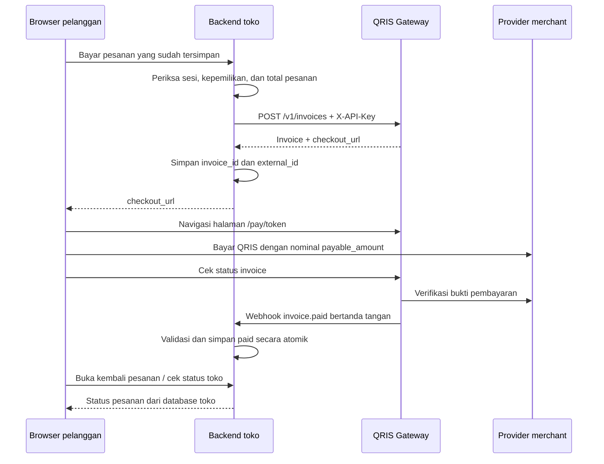

# Integrasi QRIS Gateway ke website lain

## Yang tersedia dan yang belum

Website toko, aplikasi SaaS, atau backend lain dapat membuat invoice milik merchant melalui `/v1` dengan `X-API-Key`. Pelanggan tidak perlu punya akun QRIS Gateway untuk membuka `checkout_url`. Banyak merchant dapat memakai satu deployment; setiap key mengakses data akun dan environment pemiliknya. Beberapa website milik merchant yang sama boleh memakai key terpisah, tetapi tetap berbagi kuota akun, namespace `external_id`, dan konfigurasi webhook per environment.

| Kebutuhan | Kondisi saat ini |
|---|---|
| Buat pembayaran dari backend website lain | Tersedia: `POST /v1/invoices` |
| Halaman pembayaran siap pakai | Tersedia: `checkout_url`, berbentuk `/pay/<token>` |
| Konfirmasi ke backend toko | Tersedia: webhook HMAC dan API pemeriksaan invoice |
| Uji tanpa uang nyata | Tersedia: key, invoice, dan simulator sandbox |
| Token dan SDK seperti `snap.pay(...)` | Belum tersedia; API mengembalikan objek Invoice, bukan token Snap |
| Popup JavaScript atau checkout iframe | Belum tersedia; respons gateway memakai `X-Frame-Options: DENY` |
| Redirect otomatis kembali ke toko | Belum tersedia; tidak ada kontrak `return_url`, `success_url`, atau callback browser |
| Refund otomatis | Tidak tersedia; cancel invoice bukan refund |

Ini bukan API Midtrans dan tidak kompatibel dengan SDK Snap. GoPay/ShopeePay di sini adalah sumber dompet/QRIS merchant; pelanggan membayar QRIS melalui aplikasi bank atau dompet yang mendukungnya. Aplikasi tidak menampung saldo pembayaran pelanggan. Status penyelenggara pembayaran, izin provider, lisensi upstream, dan kewajiban operasional tidak otomatis diperoleh dengan memasang perangkat lunak ini. Baca [source dan lisensi](../README.md#source-upstream-dan-lisensi).

## Arsitektur integrasi



Browser tidak memanggil `/v1` dengan key merchant. Key harus tetap di backend, walaupun dipakai dari domain berbeda. CORS tidak diperlukan untuk request antardua backend. API sesi `/api` dengan cookie dashboard bukan kontrak integrasi website lain.

Webhook hanya dikirim setelah gateway mengubah status. Worker utama berjalan setiap lima detik untuk expiry dan outbox, bukan untuk polling pembayaran seluruh invoice. Checkout memeriksa pembayaran saat pelanggan menekan tombol; backend toko juga dapat memanggil `/check`. Jangan menunggu webhook paid tanpa pernah menjalankan pemeriksaan pembayaran.

## 1. Persiapan merchant dan operator

1. Operator memasang gateway mengikuti [instalasi](../README.md#instalasi-lokal). Untuk produksi, build frontend, atur `APP_URL` ke origin HTTPS publik, dan pasang reverse proxy. `APP_URL` menentukan origin `checkout_url`; localhost pada produksi membuat tautan pelanggan salah.
2. Merchant mendaftar akun. Untuk produksi, tambahkan dompet terkelola pada **Dompet QRIS**, masukkan QRIS resmi, selesaikan autentikasi provider, lalu uji dompet. Sandbox tidak memerlukan dompet.
3. Pada **API & webhook**, pilih environment dan buat API key. Simpan secret sekali tampil di secret manager/env backend toko. Buat key terpisah untuk website berbeda agar dapat dicabut sendiri.
4. Ambil ID dompet produksi dengan `GET /v1/connections`. Pilih record dengan provider yang sesuai, `managed`, `active`, dan konfigurasi/sesi yang telah diuji. Sandbox mengembalikan `[]` dan tidak perlu `connection_id`.
5. Pasang receiver HTTPS publik toko, lalu simpan URL webhook di dashboard pada environment yang sama. Simpan secret yang baru di receiver. Satu URL berlaku untuk seluruh invoice akun pada environment tersebut; beberapa website memerlukan receiver pusat yang meneruskan event berdasarkan namespace `external_id`.
6. Pisahkan key, secret webhook, database/status pesanan, dan receiver sandbox dari produksi. Simulator sandbox tidak boleh mengirim barang atau mengaktifkan layanan produksi.

```sh
export QRIS_BASE_URL='https://GATEWAY_ANDA'
export QRIS_API_KEY='KEY_PRODUKSI_ANDA'
curl "$QRIS_BASE_URL/v1/connections" -H "X-API-Key: $QRIS_API_KEY"
```

Secret webhook berbeda dari API key. Menyimpan ulang konfigurasi webhook merotasi secret; event yang sudah antre tetap memakai URL dan secret lama. Pertahankan verifikasi secret lama hingga antrean tersebut selesai, lalu hapus secret lama. Jangan mencetak key, secret, token checkout, atau seluruh payload ke log publik.

## 2. Kontrak invoice

| Field request | Aturan |
|---|---|
| `amount` | Wajib, integer rupiah 1 sampai 1.000.000.000; hitung dari database toko, bukan input browser |
| `description` | Wajib, teks maksimal 1.000 karakter |
| `connection_id` | Wajib untuk produksi, ID dompet terkelola merchant; hilangkan untuk sandbox |
| `provider` | `gopay` atau `shopeepay`; boleh dihilangkan jika dompet menentukan provider |
| `external_id` | Opsional di gateway, tetapi selalu isi untuk integrasi; teks maksimal 200 karakter |
| `environment` | Tidak perlu dikirim; ditentukan API key. Nilai berbeda dari key ditolak |

Gunakan referensi stabil dan unik, misalnya `toko-a:production:ORDER-123:attempt-1`. Percobaan ulang request yang sama harus memakai referensi, amount, description, provider, dan connection_id yang sama. Jangan memakai timestamp baru setiap klik Bayar.

```sh
curl -i -X POST "$QRIS_BASE_URL/v1/invoices" \
  -H "X-API-Key: $QRIS_API_KEY" \
  -H 'Content-Type: application/json' \
  -d '{"connection_id":"ID_DOMPET","provider":"gopay","amount":50000,"description":"Pesanan ORDER-123","external_id":"toko-a:production:ORDER-123:attempt-1"}'
```

Sukses pembuatan, termasuk replay idempoten, memakai HTTP 201 dan objek Invoice langsung, bukan `{data: ...}`. Gunakan nilai aktual dari respons:

- `id` untuk API detail/check/cancel; `external_id` untuk mencocokkan pesanan toko.
- `amount` untuk nominal pesanan; `payable_amount` untuk nominal yang harus dibayar pelanggan. Kode unik dapat menambah Rp0 sampai Rp99. Jangan membandingkan `payable_amount` langsung dengan harga pesanan atau mengubahnya sendiri.
- `status`: `pending`, `paid`, `expired`, `cancelled`, atau `failed`.
- `checkout_url` untuk navigasi pelanggan. Token pada URL memberi akses checkout publik; jangan perlakukan sebagai bukti pembayaran.
- `expires_at`, `created_at`, dan `paid_at` berupa ISO UTC; `paid_at` dapat null.
- `qr_code` adalah payload QR, bukan gambar; `qr_url` bisa null. Checkout merender PNG lokal. QR disembunyikan setelah status tidak pending.

Pilih redirect ke checkout daripada iframe. Setelah membayar, pelanggan kembali ke tab toko secara manual; tampilkan petunjuk ini pada toko Anda. Jangan menambahkan `return_url` dan menganggap gateway akan memprosesnya.

## 3. Contoh backend lengkap yang dapat dijalankan

Contoh berikut adalah layanan integrasi internal milik toko dengan Bun dan SQLite. Backend utama toko memanggil layanan ini memakai `SHOP_API_TOKEN`; jangan memberikan token tersebut kepada browser. Layanan memuat harga pesanan dari database, membuat invoice idempoten, menyimpan mapping, memeriksa status, dan menerima webhook. Tidak perlu memasang dependency npm.

Simpan blok TypeScript berikut sebagai `integration-server.ts` di proyek toko, bukan di server QRIS Gateway. Database contoh terpisah dari database gateway. Contoh memerlukan pesanan yang sudah dibuat oleh backend toko; bagian pengujian menyediakan seed pesanan sandbox dari CLI. Untuk produksi, hubungkan sumber pesanan sebenarnya, autentikasi pengguna, pemeriksaan kepemilikan pesanan, CSRF, dan pembatasan request pada backend utama toko sebelum memanggil layanan ini.

```ts
import { Database } from 'bun:sqlite';
import { createHmac, timingSafeEqual } from 'node:crypto';

function required(name: string): string {
  const value = process.env[name];
  if (!value) throw new Error(`${name} wajib diisi`);
  return value;
}
const base = new URL(required('QRIS_BASE_URL'));
const environment = required('QRIS_ENVIRONMENT');
if (!['sandbox', 'production'].includes(environment)) throw new Error('Environment tidak valid');
const apiKey = required('QRIS_API_KEY');
const shopToken = required('SHOP_API_TOKEN');
const secrets = required('QRIS_WEBHOOK_SECRETS').split(',').map(s => s.trim()).filter(Boolean);
if (!secrets.length) throw new Error('Secret webhook wajib diisi');
const provider = required('QRIS_PROVIDER');
if (!['gopay', 'shopeepay'].includes(provider)) throw new Error('Provider tidak valid');
const connectionId = environment === 'production' ? required('QRIS_CONNECTION_ID') : null;
if (environment === 'production' && base.protocol !== 'https:') throw new Error('Produksi memerlukan HTTPS');
const db = new Database(process.env.SHOP_DATABASE_PATH || 'shop.sqlite', { create: true });
db.exec(`
  PRAGMA journal_mode = WAL;
  PRAGMA busy_timeout = 5000;
  CREATE TABLE IF NOT EXISTS orders (
    environment TEXT NOT NULL, id TEXT NOT NULL, amount INTEGER NOT NULL,
    external_id TEXT NOT NULL, invoice_id TEXT, payable_amount INTEGER, checkout_url TEXT,
    payment_status TEXT NOT NULL DEFAULT 'pending', paid_at TEXT,
    PRIMARY KEY(environment, id), UNIQUE(environment, external_id), UNIQUE(environment, invoice_id)
  );
  CREATE TABLE IF NOT EXISTS received_events (
    environment TEXT NOT NULL, id TEXT NOT NULL, PRIMARY KEY(environment, id)
  );
`);
type Order = {
  id: string; amount: number; external_id: string; invoice_id: string | null;
  payable_amount: number | null; checkout_url: string | null; payment_status: string;
};
type Invoice = {
  id: string; external_id: string; environment: string; amount: number; payable_amount: number;
  provider: string; connection_id: string | null; status: string; checkout_url: string; paid_at: string | null;
};
class HttpError extends Error {
  constructor(public status: number, message: string) { super(message); }
}
function orderById(id: string): Order {
  const order = db.query<Order, [string, string]>('SELECT * FROM orders WHERE environment = ? AND id = ?').get(environment, id);
  if (!order) throw new HttpError(404, 'Pesanan tidak ditemukan');
  return order;
}
async function gateway(path: string, method = 'GET', body?: unknown): Promise<Invoice> {
  const response = await fetch(new URL(path, base), {
    method, headers: { 'X-API-Key': apiKey, 'Content-Type': 'application/json' },
    body: body === undefined ? undefined : JSON.stringify(body),
    signal: AbortSignal.timeout(30000), redirect: 'error',
  });
  const data = await response.json();
  if (!response.ok) throw new HttpError(response.status, data.message || 'Gateway gagal');
  return data as Invoice;
}
function validateInvoice(order: Order, invoice: Invoice) {
  if (!invoice || typeof invoice.id !== 'string' || !invoice.id ||
      invoice.environment !== environment || invoice.external_id !== order.external_id ||
      invoice.amount !== order.amount || invoice.provider !== provider || invoice.connection_id !== connectionId ||
      (order.invoice_id !== null && order.invoice_id !== invoice.id) ||
      !Number.isSafeInteger(invoice.payable_amount) || invoice.payable_amount < order.amount ||
      invoice.payable_amount > order.amount + 99 ||
      (order.payable_amount !== null && order.payable_amount !== invoice.payable_amount) ||
      !['pending', 'paid', 'expired', 'cancelled', 'failed'].includes(invoice.status) ||
      (invoice.status === 'paid' && (!invoice.paid_at || !Number.isFinite(Date.parse(invoice.paid_at))))) {
    throw new HttpError(409, 'Invoice tidak cocok dengan pesanan');
  }
  const checkout = new URL(invoice.checkout_url);
  if (checkout.origin !== base.origin || !checkout.pathname.startsWith('/pay/')) {
    throw new HttpError(409, 'Origin checkout tidak sesuai');
  }
}
const saveInvoice = db.transaction((orderId: string, invoice: Invoice, eventId?: string) => {
  const order = orderById(orderId);
  validateInvoice(order, invoice);
  if (eventId) {
    const inserted = db.query('INSERT OR IGNORE INTO received_events(environment, id) VALUES (?, ?)').run(environment, eventId);
    if (!inserted.changes) return;
  }
  db.query(`UPDATE orders SET invoice_id = ?, payable_amount = ?, checkout_url = ?,
    payment_status = CASE WHEN payment_status = 'paid' THEN 'paid' ELSE ? END,
    paid_at = COALESCE(paid_at, ?) WHERE environment = ? AND id = ?`)
    .run(invoice.id, invoice.payable_amount, invoice.checkout_url, invoice.status, invoice.paid_at, environment, orderId);
});
function signatureValid(raw: Buffer, signature: string): boolean {
  if (!/^sha256=[0-9a-f]{64}$/.test(signature)) return false;
  const received = Buffer.from(signature.slice(7), 'hex');
  return secrets.some(secret => timingSafeEqual(received, createHmac('sha256', secret).update(raw).digest()));
}
function shopAuthorized(request: Request): boolean {
  const received = Buffer.from(request.headers.get('authorization') || '');
  const expected = Buffer.from(`Bearer ${shopToken}`);
  return received.length === expected.length && timingSafeEqual(received, expected);
}
const server = Bun.serve({
  hostname: '127.0.0.1', port: Number(process.env.SHOP_PORT || 3200), maxRequestBodySize: 65536,
  async fetch(request) {
    try {
      const path = new URL(request.url).pathname;
      if (path === '/webhooks/qris' && request.method === 'POST') {
        const raw = Buffer.from(await request.arrayBuffer());
        if (!signatureValid(raw, request.headers.get('X-QRIS-Signature') || '')) {
          throw new HttpError(401, 'Signature tidak valid');
        }
        const event = JSON.parse(raw.toString('utf8'));
        if (!event || typeof event.id !== 'string' || !event.id ||
            event.id !== request.headers.get('X-QRIS-Event-Id') ||
            event.data?.environment !== environment ||
            request.headers.get('X-QRIS-Environment') !== environment ||
            !['paid', 'expired', 'cancelled', 'failed'].includes(event.data?.status) ||
            event.event !== `invoice.${event.data.status}`) {
          throw new HttpError(400, 'Event tidak valid atau environment berbeda');
        }
        if (db.query('SELECT id FROM received_events WHERE environment = ? AND id = ?').get(environment, event.id)) {
          return new Response(null, { status: 204 });
        }
        const order = db.query<Order, [string, string]>('SELECT * FROM orders WHERE environment = ? AND external_id = ?')
          .get(environment, event.data.external_id);
        if (!order) throw new HttpError(409, 'Pesanan untuk event belum ditemukan');
        validateInvoice(order, event.data);
        // Ambil status terkini agar event expired yang terlambat tidak menimpa paid.
        const invoice = await gateway(`/v1/invoices/${encodeURIComponent(event.data.id)}`);
        saveInvoice(order.id, invoice, event.id);
        return new Response(null, { status: 204 });
      }
      if (!shopAuthorized(request)) throw new HttpError(401, 'Akses backend toko ditolak');
      const match = /^\/orders\/([^/]+)\/(pay|status)$/.exec(path);
      if (!match) throw new HttpError(404, 'Endpoint tidak ditemukan');
      const order = orderById(decodeURIComponent(match[1]!));
      if (match[2] === 'pay' && request.method === 'POST') {
        if (order.invoice_id) {
          const invoice = await gateway(`/v1/invoices/${encodeURIComponent(order.invoice_id)}`);
          saveInvoice(order.id, invoice);
          if (invoice.status !== 'pending') throw new HttpError(409, `Invoice ${invoice.status}; jangan bayar ulang`);
          return Response.json({ invoice_id: invoice.id, checkout_url: invoice.checkout_url });
        }
        const invoice = await gateway('/v1/invoices', 'POST', {
          amount: order.amount, description: `Pesanan ${order.id}`, external_id: order.external_id,
          provider, ...(connectionId ? { connection_id: connectionId } : {}),
        });
        saveInvoice(order.id, invoice);
        if (invoice.status !== 'pending') throw new HttpError(409, `Invoice ${invoice.status}; jangan bayar ulang`);
        return Response.json({ invoice_id: invoice.id, checkout_url: invoice.checkout_url });
      }
      if (match[2] === 'status' && request.method === 'POST') {
        if (order.invoice_id) {
          const invoice = await gateway(`/v1/invoices/${encodeURIComponent(order.invoice_id)}/check`, 'POST');
          saveInvoice(order.id, invoice);
        }
        return Response.json({ order_id: order.id, environment, status: orderById(order.id).payment_status });
      }
      throw new HttpError(405, 'Gunakan POST');
    } catch (error) {
      if (error instanceof HttpError) return Response.json({ message: error.message }, { status: error.status });
      if (error instanceof SyntaxError || error instanceof URIError) {
        return Response.json({ message: 'Permintaan tidak valid' }, { status: 400 });
      }
      return Response.json({ message: 'Integrasi gagal; periksa backend dan coba referensi yang sama' }, { status: 502 });
    }
  },
});
console.log(`Integrasi toko: http://${server.hostname}:${server.port}`);
```

`saveInvoice` menyimpan event dan status pesanan dalam satu transaksi. Webhook dapat tiba sebelum respons create disimpan; pencocokan memakai `external_id` yang sudah ada pada pesanan, lalu mengikat invoice secara atomik. Event berulang tidak menggandakan pemrosesan. Status `paid` tidak diturunkan oleh event lama atau respons pending yang terlambat. Handler membaca status gateway terkini, sehingga kegagalan API menghasilkan non-2xx dan event dapat dikirim ulang.

Contoh hanya memperbarui pembayaran pesanan. Jika perlu mengirim barang, email, saldo, atau aktivasi layanan, tulis pekerjaan fulfillment unik per pesanan ke outbox toko dalam transaksi `saveInvoice` yang sama ketika pertama menjadi paid. Jalankan efek eksternal setelah commit dengan consumer idempoten; jangan mengirim barang langsung dari callback sebelum commit. Sandbox hanya boleh mengisi outbox uji, tidak menjalankan fulfillment produksi.

Contoh memakai satu konfigurasi provider/dompet dan satu percobaan pembayaran per pesanan. Untuk checkout ulang setelah gagal/expired/cancelled, rekonsiliasi percobaan lama dahulu, lalu simpan record payment attempt baru dengan referensi baru. Jangan menimpa mapping invoice lama; pembayaran tepat waktu pada invoice expired masih mungkin direkonsiliasi menjadi paid.

## 4. Hubungkan frontend toko

Backend utama toko menyediakan endpoint sendiri, misalnya `POST /payments/ORDER-123`. Endpoint tersebut harus:

1. Memverifikasi sesi pelanggan, kepemilikan pesanan, CSRF, dan state pesanan.
2. Memanggil `POST /orders/ORDER-123/pay` pada layanan integrasi dengan bearer internal.
3. Mengembalikan `{checkout_url}` kepada browser, atau membalas HTTP 303 ke URL tersebut untuk form POST.

Browser menggunakan sesi toko saja. Contoh untuk endpoint milik toko yang sudah menerapkan langkah di atas:

```js
async function bayarPesanan(orderId, csrfToken) {
  const response = await fetch(`/payments/${encodeURIComponent(orderId)}`, {
    method: 'POST', credentials: 'same-origin',
    headers: { 'X-CSRF-Token': csrfToken },
  });
  const result = await response.json();
  if (!response.ok) throw new Error(result.message || 'Tidak dapat membuat pembayaran');
  window.location.assign(result.checkout_url);
}
```

Tampilkan loading, cegah klik ganda di UI, dan tampilkan error tanpa menandai pesanan lunas. Idempotensi backend tetap wajib karena dua tab atau request bersamaan dapat melewati penguncian tombol. Untuk popup browser biasa, buka tab kosong dari klik pengguna terlebih dahulu agar tidak diblokir, kemudian navigasikan ke URL; ini bukan SDK Snap dan tidak menyediakan callback pembayaran.

Saat pelanggan kembali ke toko, baca status melalui backend toko. Jangan menerima `?status=paid`, `postMessage`, redirect sukses, atau callback JavaScript sebagai bukti lunas. Bila webhook terlambat/hilang, backend dapat memanggil `/check`, lalu menyimpan status hasil verifikasi. Jadwalkan pemeriksaan pending di backend dengan jeda konservatif, misalnya minimal 15 detik per invoice, bukan setiap render atau setiap pelanggan polling. Jeda ini rekomendasi integrator, bukan janji rate limit API.

## 5. Menjalankan dan menguji sandbox

Siapkan gateway yang berjalan, key sandbox, dan secret webhook sandbox. Isi konfigurasi layanan toko pada shell privat; jangan commit file berisi rahasia:

```sh
export QRIS_BASE_URL='http://127.0.0.1:3100'
export QRIS_ENVIRONMENT='sandbox'
export QRIS_API_KEY='KEY_SANDBOX_ANDA'
export QRIS_PROVIDER='gopay'
export QRIS_WEBHOOK_SECRETS='SECRET_WEBHOOK_SANDBOX_ANDA'
export SHOP_API_TOKEN='TOKEN_INTERNAL_ACAK_ANDA'
export SHOP_DATABASE_PATH='./shop-sandbox.sqlite'
export SHOP_PORT='3200'
bun integration-server.ts
```

Gateway lokal memerlukan frontend Vite pada development, atau frontend hasil build pada mode produksi. `APP_URL` gateway harus menunjuk origin yang benar-benar melayani checkout. Contoh HTTP di atas hanya untuk sandbox lokal. Receiver produksi tetap HTTPS publik melalui reverse proxy.

Sesudah layanan membuat tabel, muat ulang variabel env di atas pada shell kedua tanpa menjalankan server lagi, dan gunakan direktori kerja yang sama agar `SHOP_DATABASE_PATH` menunjuk database yang sama. Jalankan seed berikut sekali; pesanan dan nominalnya adalah data uji, bukan pesanan pelanggan:

```sh
bun -e 'import { Database } from "bun:sqlite"; const db = new Database(process.env.SHOP_DATABASE_PATH || "shop-sandbox.sqlite"); db.query("INSERT INTO orders(environment,id,amount,external_id) VALUES (?,?,?,?)").run("sandbox","ORDER-UJI-1",50000,"toko-a:sandbox:ORDER-UJI-1:attempt-1"); db.close();'

curl -X POST 'http://127.0.0.1:3200/orders/ORDER-UJI-1/pay' \
  -H "Authorization: Bearer $SHOP_API_TOKEN"
```

Simpan `invoice_id` dan buka `checkout_url` dari respons. Ulangi request pay sebelum simulasi: ID harus sama. QR sandbox berisi tautan uji, bukan QRIS untuk dibayar dengan bank/dompet.

```sh
export INVOICE_ID='ID_DARI_RESPONS'
curl -X POST "$QRIS_BASE_URL/v1/invoices/$INVOICE_ID/simulate" \
  -H "X-API-Key: $QRIS_API_KEY" -H 'Content-Type: application/json' \
  -d '{"action":"paid"}'

curl -X POST 'http://127.0.0.1:3200/orders/ORDER-UJI-1/status' \
  -H "Authorization: Bearer $SHOP_API_TOKEN"
```

Hasil status yang diharapkan: `{"order_id":"ORDER-UJI-1","environment":"sandbox","status":"paid"}`. Ini simulasi; tidak ada dana diterima. Gunakan pesanan dan invoice baru untuk menguji `failed`, `expired`, dan cancel. Status terminal simulator tidak dapat diubah kembali.

Untuk webhook otomatis, pasang receiver pada HTTPS publik yang meneruskan `/webhooks/qris` ke layanan loopback tanpa mengubah raw body, lalu konfigurasi URL tersebut sebelum membuat event. Gateway menolak localhost, IP private, dan redirect; tunnel HTTPS publik boleh dipakai untuk QA, bukan untuk mengekspos database atau endpoint internal tanpa autentikasi.

Tanpa receiver publik, receiver lokal dapat diuji dengan payload **outbox sandbox yang benar-benar dibuat gateway** dan secret sandbox. Simpan body persis sebagai `event.json`, bukan JSON yang diserialisasi ulang. Operator dapat mengambil payload dari database QA/outbox; jangan menyalin database produksi. Perintah berikut hanya QA dan tidak membuktikan pengiriman HTTPS otomatis:

```sh
export EVENT_ID='ID_EVENT_DALAM_EVENT_JSON'
export SIGNATURE="$(bun -e 'import { createHmac } from "node:crypto"; const raw = await Bun.file("event.json").arrayBuffer(); console.log("sha256=" + createHmac("sha256", process.env.QRIS_WEBHOOK_SECRETS.split(",")[0]).update(Buffer.from(raw)).digest("hex"));')"
curl -i -X POST 'http://127.0.0.1:3200/webhooks/qris' \
  -H 'Content-Type: application/json' -H "X-QRIS-Event-Id: $EVENT_ID" \
  -H 'X-QRIS-Environment: sandbox' -H "X-QRIS-Signature: $SIGNATURE" \
  --data-binary @event.json
```

Receiver membalas 204 setelah commit. Kirim body identik dua kali: status tetap paid dan satu event tersimpan. Ubah satu byte body tanpa menghitung signature baru: harus 401. Kirim event sandbox ke receiver produksi: tidak boleh mengubah pesanan produksi. Jangan menghapus deduplikasi setelah beberapa menit; retry manual dapat terjadi jauh lebih lama.

## 6. Webhook dan pemetaan status

Event: `invoice.paid`, `invoice.expired`, `invoice.cancelled`, `invoice.failed`. Tidak ada event `invoice.pending` atau `invoice.created`. Body: `{id,event,created_at,data:Invoice}`. Header: `X-QRIS-Event-Id`, `X-QRIS-Environment`, `X-QRIS-Signature: sha256=<hex>`. Signature adalah HMAC-SHA256 atas raw body menggunakan secret webhook, bukan API key.

Urutan receiver: baca raw bytes, verifikasi signature dengan constant-time comparison, parse JSON, cocokkan environment/header/event/invoice/referensi/nominal, deduplikasi dalam transaksi, simpan state, commit, lalu balas 2xx. Untuk gateway ini, `invoice.expired` dapat disusul `invoice.paid` bila bukti membuktikan pembayaran sebelum expiry; jangan menganggap event selalu berurutan.

| Status gateway | Tindakan toko |
|---|---|
| `pending` | Tunggu pembayaran; tampilkan nominal `payable_amount` |
| `paid` | Tandai pembayaran terverifikasi; fulfillment satu kali dan hanya untuk produksi |
| `expired` | Hentikan instruksi bayar; rekonsiliasi jika pelanggan sudah membayar tepat waktu |
| `cancelled` | Hentikan instruksi bayar; transfer yang sudah terjadi tidak ditarik kembali |
| `failed` | Tampilkan kegagalan dan rekonsiliasi sebelum membuat attempt baru |

Pengiriman at-least-once, maksimal enam percobaan otomatis. Setelah kegagalan, jeda retry berturut-turut 1 menit, 5 menit, 30 menit, 2 jam, dan 6 jam; worker menambahkan jeda scheduling. Timeout receiver 10 detik; jangan jalankan fulfillment lambat di request webhook. Balasan 3xx bukan sukses dan redirect tidak diikuti. Riwayat/retry manual tersedia pada **API & webhook**, sesuai environment. Jika webhook dinonaktifkan, pengiriman berhenti. Menyimpan URL setelah event terjadi tidak membuat ulang event lama yang sebelumnya tidak diantrekan; gunakan API untuk rekonsiliasi.

## 7. Error, timeout, dan retry

Semua error gateway berbentuk `{ "message": "..." }`. Simpan status HTTP, invoice ID, dan referensi untuk diagnosis internal, tetapi jangan mengirim rahasia ke log pelanggan.

| Kondisi | Tindakan |
|---|---|
| 400 | Perbaiki field atau environment; jangan retry input yang sama terus-menerus |
| 401 | Periksa key hilang/dicabut atau signature salah |
| 403/404 | Periksa tenant, environment, dan kepemilikan dompet/invoice |
| 409 | Periksa konflik data/state atau create yang masih berjalan; jangan langsung membuat referensi baru |
| 429 | Kuota harian atau rate limit; kurangi request/periksa paket, bukan loop cepat |
| 502/503/504 atau timeout jaringan | Status pembuatan/pembayaran bisa belum diketahui; rekonsiliasi dengan referensi sama dahulu |

Jika respons create hilang setelah gateway menyimpan invoice, ulangi request dengan `external_id` dan isi identik untuk memperoleh invoice yang sama. Jika perlu, cari referensi melalui `GET /v1/invoices` dari backend. Referensi yang creation-nya gagal tidak dapat dipakai membuat ulang; setelah rekonsiliasi, buat attempt baru. Jangan retry status `paid` sebagai pembayaran baru.

Gratis produksi dibatasi lima invoice per hari WIB untuk seluruh dompet akun; invoice yang berhasil dibuat tetap menghitung kuota meski dibatalkan atau kedaluwarsa. Paket aktif menghapus batas harian tersebut. Sandbox tidak memakai kuota, dan key sandbox tidak bisa membaca invoice produksi. Sewa/kuota habis tidak menghalangi pemeriksaan invoice lama.

## 8. Checklist sebelum produksi

- Set `QRIS_ENVIRONMENT=production`, key dan secret produksi, `QRIS_CONNECTION_ID` dompet merchant yang telah diuji, HTTPS gateway, dan database produksi terpisah. Jangan mengubah baris sandbox menjadi produksi.
- Lindungi route pesanan dengan sesi/ownership/CSRF/rate limit pada toko. Jalur webhook menggunakan HMAC, bukan sesi pelanggan. Jangan expose bearer internal atau API key gateway ke browser.
- Buat pesanan dan harga dari database toko; referensi berawalan identitas website jika satu akun digunakan beberapa toko. Backend menentukan provider/dompet, bukan query URL pelanggan.
- Atur receiver HTTPS publik tanpa redirect. Proxy harus mempertahankan body dan header signature; pengecualian parser JSON global harus berlaku sebelum route webhook.
- Uji webhook valid, signature salah, event duplikat, event terlambat, receiver non-2xx, request create bersamaan, timeout create, dan pembatasan environment. Pastikan status paid dan fulfillment tidak terulang atau turun.
- Periksa status pending dari backend bila pelanggan tidak menekan Cek status. Batasi frekuensi dan jumlah pekerjaan; jangan menganggap worker outbox melakukan polling provider.
- Simpan mapping setiap payment attempt, event dedup, dan fulfillment secara persisten; backup database toko dan gateway secara konsisten, simpan rahasia di luar Git, serta siapkan rotasi key/secret.
- Jalankan pembayaran produksi bernilai kecil milik Anda untuk setiap provider yang dipakai. Cocokkan nama penerima, `payable_amount`, mutasi provider, status paid, dan callback toko. Jangan menggunakan simulator sebagai bukti settlement produksi.
- Tetapkan penanganan pembayaran terlambat, refund manual, dukungan pelanggan, dan kegagalan upstream. `/cancel` bukan refund; `/check` pada expired hanya melunaskan bukti pembayaran tepat waktu yang belum diklaim invoice lain.
- Pastikan frontend gateway hasil build tersedia dan tautan checkout dapat dibuka pelanggan tanpa login. Tidak ada redirect kembali otomatis; toko memberi petunjuk kembali dan membaca status dari backend.

## 9. Usulan pengembangan checkout ala Snap

Belum ada SDK Snap atau jadwal rilis yang tercatat dalam implementasi saat ini. Arah berikut adalah **usulan desain**, bukan API yang dapat dipanggil sekarang, bukan janji rilis, dan bukan kompatibilitas Midtrans:

1. Pertahankan hosted checkout/redirect sebagai dasar. Tambahkan kontrak URL kembali yang divalidasi terhadap domain merchant; redirect hanya navigasi, bukan bukti paid.
2. Tambahkan sesi checkout publik berumur terbatas yang terikat pada invoice dan environment, tanpa mengekspos API key. Tentukan akses setelah expiry/cancel, refresh halaman, serta rekonsiliasi.
3. Sediakan SDK JavaScript milik proyek untuk membuka checkout dan memberi notifikasi UI pending/success/close/error. Backend tetap menentukan status final lewat webhook/API. Menutup popup tidak otomatis membatalkan invoice.
4. Jika embedded iframe benar-benar dibutuhkan, desain allowlist origin merchant dan CSP `frame-ancestors` terlebih dahulu; evaluasi clickjacking, `postMessage` dengan origin/source validation, popup blocker, dan fallback redirect. Jangan sekadar menghapus header DENY global.
5. Tulis kontrak, contoh instalasi, versi SDK, serta pengujian lintas origin/mobile dan skenario replay/expiry sebelum menyatakan tersedia.

Untuk integrasi sekarang, gunakan API backend + `checkout_url` + webhook. Usulan ini tidak memerlukan perubahan pada toko yang sudah memakai alur redirect tersebut.

## 10. Bukti verifikasi panduan

Blok `integration-server.ts` di atas diekstrak tanpa perubahan dan dijalankan sebagai proses Bun tersendiri terhadap server HTTP gateway asli dengan database QA terisolasi. Smoke HTTP membuktikan:

- Akses backend tanpa token ditolak 401; dua create bersamaan menghasilkan satu invoice dan harga tetap dari database, bukan body request.
- Checkout publik terbaca pending tanpa login dan header frame tetap DENY.
- Simulator gateway membuat event outbox nyata. Replay lokal event valid dan duplikat mendapat 204 dengan satu event tersimpan; body diubah mendapat 401, environment berbeda 400, dan nominal salah 409.
- Paid/failed/expired/cancelled tersimpan sesuai hasil gateway; pembayaran ulang invoice terminal ditolak. Secret webhook lama yang masih dikonfigurasi dapat memverifikasi event.
- Webhook sebelum mapping invoice tersimpan tetap terikat lewat referensi pesanan; event expired yang datang setelah paid tidak menurunkan status.
- Restart layanan mempertahankan mapping, status paid, dan deduplikasi event. Respons pemeriksaan status cocok dengan contoh JSON sandbox pada panduan.

Batas verifikasi: replay webhook dilakukan lokal dari payload outbox, bukan pengiriman HTTPS publik otomatis. Pembayaran produksi, fulfillment toko, halaman browser toko, dan navigasi visual frontend tidak diuji dalam pekerjaan dokumentasi ini. Tidak ada perubahan perilaku aplikasi gateway atau database pengguna.
